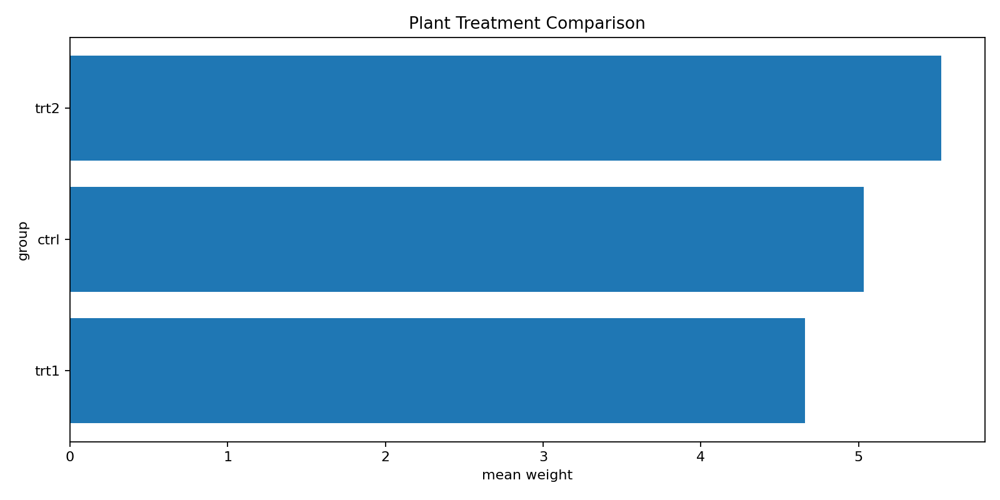

# Plant Treatment Comparison — executed results

## Decision question
How does dry plant weight differ across treatment groups?

## Evidence
The largest observed mean weight is 5.526 for trt2. This ranking is descriptive, not a recommendation.

Raw rows: 30. Rows used: 30. Excluded for missing/nonfinite required values or invalid denominator: 0.

## Method
Complete-case descriptive comparison of weight by group; show group counts, mean, minimum and maximum.

## Interpretation and limitations
Only ten observations per group; sample mean rankings can be unstable. No causal inference, significance claim or production deployment is implied. Missing values are not imputed; identical rows are retained. Small or repeated samples limit uncertainty interpretation.

## Recommended next decision
Repeat the experiment with a preregistered design.

## Reproducibility
Source and exact downloaded-byte SHA256 are recorded in run_manifest.json. SQL results are in answer.csv and analysis.sqlite. Review quality_audit.csv before interpretation.
